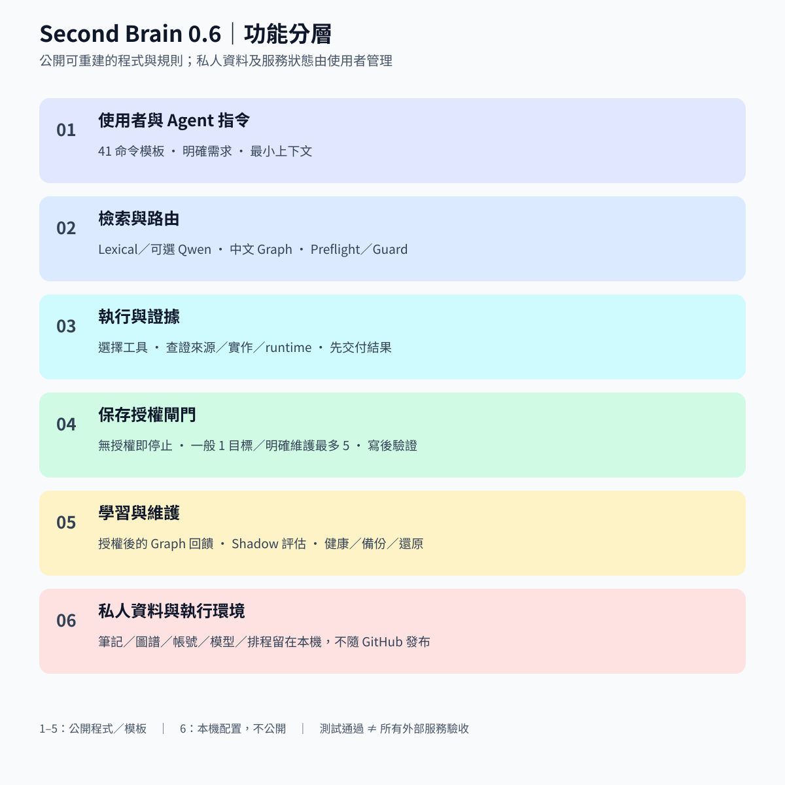
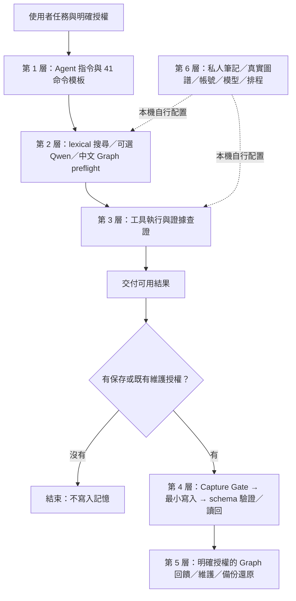

# 第二大腦：功能層級與公開範圍

版本 0.6，2026-11-03。公開的是可重建工作流程的程式與規則；每位使用者的知識、證據、連接器與機器狀態仍由自己管理。

| 層級 | GitHub 0.6 提供 | 驗證與界線 |
|---|---|---|
| 1：指令與規則 | 41 命令模板、通用 AI-first references、保護既有檔案的 installer | 安裝與授權契約可測；命令是 agent 操作指示，不是所有服務均已連線。 |
| 2：檢索與路由 | lexical 搜尋、可選 Qwen 介面、中文分詞與 ranking、preflight、attempt-guard | 合成資料驗證；不附私人向量索引與模型權重，Qwen 真實模型推論未包含於通用測試。 |
| 3：執行與證據 | evidence-chain、證據包、來源與執行狀態界線 | 不附服務登入、ERP 或生產資料；記憶與會議內容不能證明目前 runtime。 |
| 4：保存控制 | 一般保存一目標、明確多檔維護五目標、manifest、寫後 schema delta | `AUTO_CAPTURE` 拒絕；allowed/token/旗標都不是使用者授權。 |
| 5：學習與維護 | graph feedback、shadow runtime、health、privacy、status、provenance、備份與隔離還原、保留檢查、OKF 匯出 | 有寫入的指令需相應授權；shadow 僅評估，不自動注入；外部政策與案例由使用者提供。 |
| 6：私人環境 | 僅提供如何配置的文件與通用介面 | 不發布私人筆記、真實 graph、transcript、SQLite/WAL、憑證、瀏覽器狀態、雲端排程與模型快取。 |

## 與平常使用版本的關係

上次遠端為 0.4 參考 CLI 加更新文件；本次先合入原本未公開的 0.5 hardening 提交，再將可公開的日常控制面移植到 `system/vault-runtime/`。一般化處理去除個人預設路徑、企業案例與私有政策，補上可攜安裝及合成測試。

日常版與公開 runtime 共用相同類型的命令、schema gate、Graph 與維護流程；這不表示私人環境、資料、連接器、排程或模型已複製。舊 `second-brain` 參考 CLI 與完整 runtime 的 CLI 介面仍分開：前者簡潔且保留相容性，後者用安裝後的 `.codex/scripts/` 與 `Knowledge/Codex/memory_graph/`。不可混用兩種 graph 格式或將真實資料直接換成 demo fixture。

## 授權修正

- 完成任務、失敗、使用者糾正及有用洞見都不再被描述為自動保存的理由。
- 普通保存 `EXPLICIT_COMMAND`：最多一個目標。
- 明確多檔維護 `EXPLICIT_MAINTENANCE`：每個 manifest 最多五個。
- `WEEKLY_CONSOLIDATION`：只能套用既有已授權排程的範圍。
- `AUTO_CAPTURE`：拒絕，即使已交付也不例外。
- Graph 的寫入需明確旗標與相應授權；preflight 提示不再要求每次工作後記錄。
- 舊 PINNED／Daily／backlink／規則升級的自動寫入描述已在公開模板改成有界且需授權。

## 安裝與重建

依 [安裝說明](installation.md) 在自己的 vault 安裝，先 dry-run。新增命令與腳本不會自動覆寫現有檔案或登入任何服務。共用基線為 Python 3.12+、macOS/Linux；OKF 需要 PyYAML，iCloud materialize 另需 macOS。可攜來源隨 Git repository 發布；pip 安裝只提供 reference CLI。

測試只使用合成 vault、合成 graph 與隔離備份目錄。CI 以多個 Python 版本檢查公開程式，不等同完整私人系統、外部服務或生產環境驗收。
